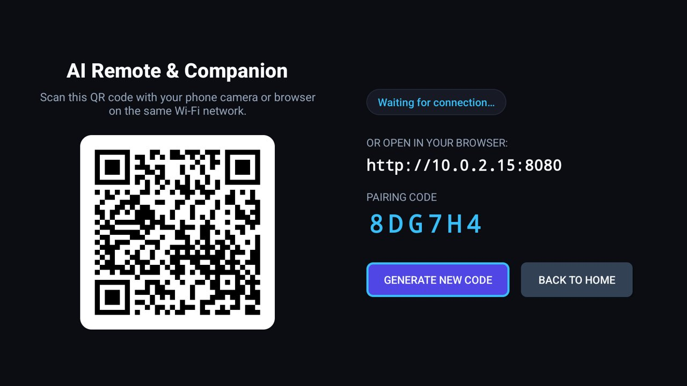

# Web Remote & Companion

A fast, lightweight phone web remote for your TV. Scan a QR code on your TV screen to open a modern companion
remote on your phone—complete with a tactile D-pad, real-time TV keyboard, volume controls, and instant app launcher.

For the [Clean Your TV](../../README.md) launcher, it declares a [module card](../../docs/modules.md): once you
answer **Show card**, its tile reads "Web Remote" with an indigo glow. On any other Android TV home, it is an
ordinary app.



## Features

- **Phone Web Remote**: No app to install from an app store. Just scan the on-screen QR code on your home Wi-Fi to
  open the remote in your phone's browser.
- **Tactile D-Pad & Volume Controls**: Responsive navigation with hold-to-repeat for continuous scrolling.
- **TV Keyboard**: Type search queries and passwords on your phone's keyboard and send them straight to the TV.
- **Dynamic App Catalog**: Detects newly installed and sideloaded apps in real time via an Android `BroadcastReceiver`
  and displays them in a clean vertical grid with tap-to-launch.
- **100% Native Java**: Pure Android SDK implementation with zero heavy frameworks, running in $< 12$ MB of RAM.

## Permissions

| Permission | Why |
|---|---|
| `INTERNET` | For the embedded local HTTP and WebSocket server on your home Wi-Fi network. |
| `ACCESS_NETWORK_STATE` | To read the TV's local IP address so it can be displayed on screen and in the pairing QR code. |
| `WRITE_SECURE_SETTINGS` | To keep the remote accessibility service enabled for system-wide navigation and home controls. |
| `QUERY_ALL_PACKAGES` | To discover installed TV apps (YouTube, Netflix, etc.) and launch them on tap. |

No cloud servers, telemetry, accounts, or analytics. The TV app makes zero outbound internet connections.

## Build and install

JDK 17 and Android SDK platform 34 with build-tools 34.0.0, as for the launcher. From the repo root, with ADB on:

```bash
cd addons/ai-remote && ./gradlew assembleRelease && cd ../..
TV_HOST=<tv ip> tools/venv/bin/python -I tools/tv.py --push addons/ai-remote/app/build/outputs/apk/release/app-release.apk /data/local/tmp/addon.apk
TV_HOST=<tv ip> tools/venv/bin/python -I tools/tv.py 'pm install -r /data/local/tmp/addon.apk; rm -f /data/local/tmp/addon.apk'
```

## Tested on

Android Studio Emulator (Android TV 14, API 34); Lumio Arc 5 projector (Google TV 14, MediaTek MT9630).

## Maintainer

CleanYourTV Community
